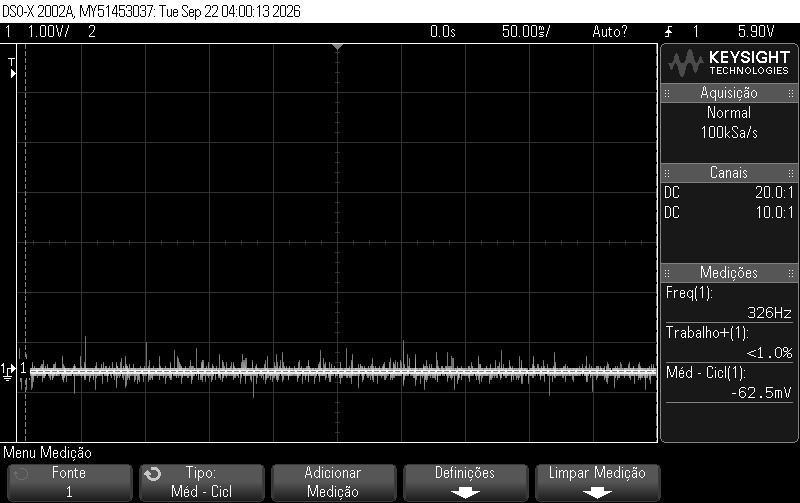
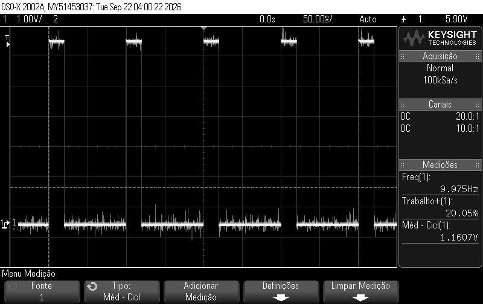
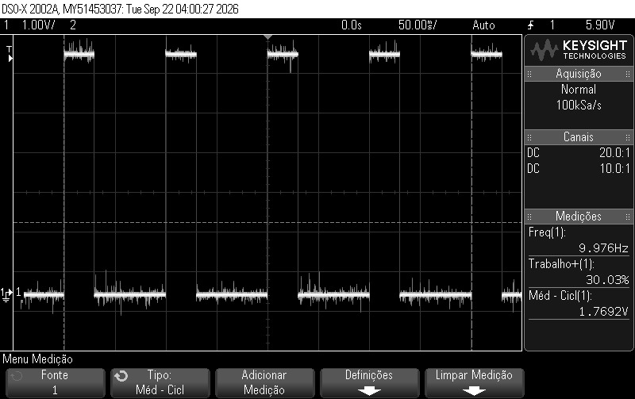
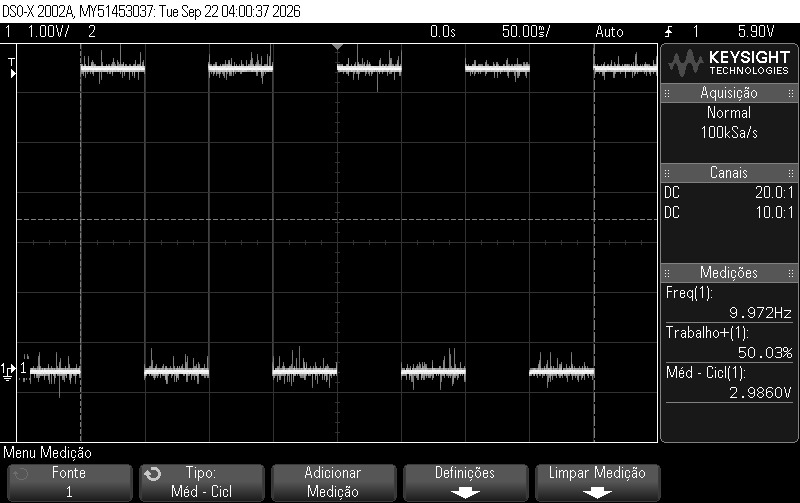
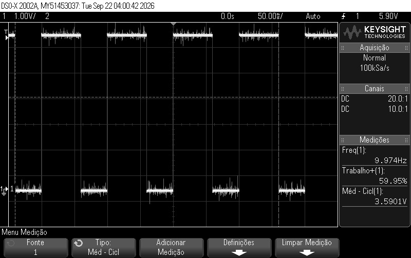
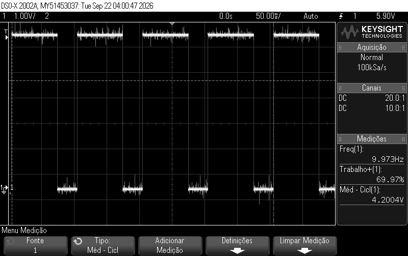
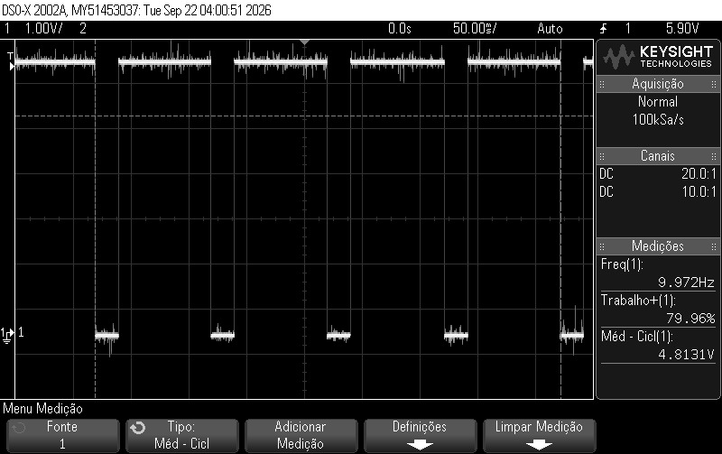
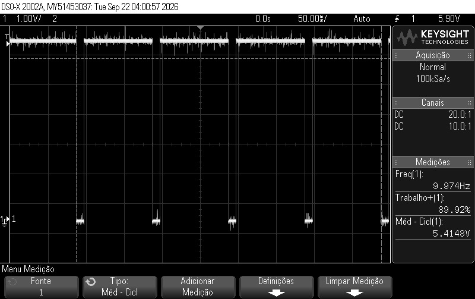
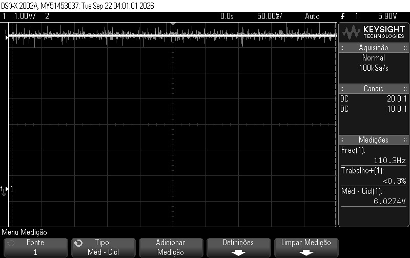

# Projeto 1 (Prática 3): GPIO, Python e Computação Paralela
**Disciplina:** SEL0337 - Projetos em Sistemas Embarcados
**Autores:**
- Eduardo Magaldi Magno - 15448780
- Lucas Garcia Pereira - 15496307

## Objetivo do Projeto

Este projeto tem como objetivo introduzir o desenvolvimento de software de alto nível em Python aplicado a sistemas Linux embarcados utilizando a plataforma Raspberry Pi. Ao longo das três etapas práticas, são explorados os fundamentos da linguagem (estruturas condicionais, laços de repetição, funções, *type casting*, formatação de strings e tratamento de exceções) integrados ao controle de hardware por meio do barramento GPIO (*General Purpose Input/Output*).

Em sistemas operacionais embarcados baseados em Linux, o acesso aos pinos físicos é gerenciado pelo kernel por meio de subsistemas como `sysfs` (`/sys/class/gpio`) ou `libgpiod` (`/dev/gpiochip*`), cuja complexidade é abstraída em Python pelas bibliotecas `RPi.GPIO` (controle direto de baixo nível) e `gpiozero` (interface orientada a objetos de alto nível). O escopo do projeto divide-se em três etapas principais:
- **Parte 1 (Checkpoint 1):** Configuração de ambientes virtuais (`venv`) para isolamento de dependências, leitura de entradas digitais com detecção de borda/eventos (interrupções via software) e acionamento de saídas digitais com temporização e validação de dados de entrada.
- **Parte 2 (Checkpoint 2):** Controle de saídas moduladas por largura de pulso (PWM) com análise de sinal via osciloscópio e integração prática de sensores e atuadores ao barramento GPIO.
- **Parte 3 (Checkpoint 3):** Implementação de computação concorrente e paralela em sistemas multicore utilizando processos (`multiprocessing`) e *threads* (`threading`), abordando escalonamento de tarefas, exclusão mútua (*mutex*), semáforos e prevenção de *deadlocks*.

---

## Parte 1 - Introdução à GPIO, Ambiente Virtual e Tratamento de Eventos

Nesta primeira etapa, foi configurado um ambiente virtual Python isolado (`venv`) nomeado `8007` (composto pelos dois últimos dígitos do NUSP de cada integrante da dupla) para a instalação restrita das bibliotecas `RPi.GPIO` e `gpiozero`. Em seguida, foram desenvolvidos dois scripts utilizando o esquema de numeração `GPIO.BCM` (canais do System-on-Chip da Broadcom):
1. **`blink.py`:** Acionamento de um LED a partir do estado de um botão (*push button*) configurado com resistor de *pull-up* interno e detecção assíncrona de eventos de borda (`GPIO.add_event_detect`), evitando o uso de *polling* contínuo na CPU.
2. **`counter.py`:** Temporizador de contagem regressiva via terminal com validação de entrada do usuário (*type casting* e tratamento de exceções com `try-except ValueError`), formatação dinâmica na mesma linha (`MM:SS`) e acionamento de saída digital ao final da contagem.

### Mapeamento de Hardware

| Componente                | Pino RASP                       | Função                                                                                     |
|---------------------------|---------------------------------|--------------------------------------------------------------------------------------------|
| LED Vermelho (+ Resistor) | `GPIO 23` (Pino Físico 16)      | Saída digital (`GPIO.OUT`) acionada pelo botão ou pelo término da contagem regressiva.     |
| Botão (*Push Button*)     | `GPIO 24` (Pino Físico 18)      | Entrada digital (`GPIO.IN`) configurada com resistor de *pull-up* interno (`GPIO.PUD_UP`). |
| GND (Terra)               | `Ground` (Pinos Físicos 6 e 14) | Referência comum (0 V) para o cátodo do LED e para o terminal do botão.                    |

### Códigos - Arquitetura e Lógica de Implementação

#### 1. Acionamento de LED por Botão (`blink.py`)
Para evitar o uso bloqueante de *polling* contínuo na CPU, a leitura do botão e o acionamento do LED foram implementados por meio de interrupções de borda gerenciadas via software.

- **Configuração em *Pull-Up* e Lógica Invertida:** O pino `GPIO 24` foi configurado com o resistor de *pull-up* interno habilitado (`GPIO.PUD_UP`), mantendo nível lógico alto (`True`) com a chave aberta e caindo para nível lógico baixo (`False`) quando pressionada ao GND. Na função de *callback*, essa leitura é avaliada de forma complementar para acender o LED (`GPIO 23`) no pressionamento e apagá-lo na soltura.
- **Detecção Assíncrona e Filtro de *Debounce*:** A função `GPIO.add_event_detect` monitora ambas as bordas de transição (`GPIO.BOTH`) e dispara a rotina `button(pin)` apenas quando há mudança de estado físico. Foi aplicado um parâmetro `bouncetime=200` (200 ms) para filtrar trepidações mecânicas do contato (*bouncing*).
- **Liberação Segura de Recursos (*Cleanup*):** O laço principal é protegido por uma estrutura `try-except KeyboardInterrupt` associada ao bloco `finally`. Ao encerrar o programa via `CTRL+C`, o método `GPIO.cleanup()` reseta os pinos utilizados para alta impedância, prevenindo curtos-circuitos em execuções futuras.

#### 2. Contagem Regressiva com Validação de Entrada (`counter.py`)
O sistema solicita ao usuário um tempo em segundos via terminal, realiza a validação de integridade da entrada e executa um cronômetro regressivo antes de acionar a saída digital do LED.

- **Validação de Entrada e *Type Casting*:** Como a leitura via `input()` retorna uma string, o dado é convertido para inteiro (`int()`) dentro de um bloco `try-except ValueError`. Entradas alfanuméricas ou valores de ponto flutuante são interceptados sem interromper a execução do script, enquanto uma estrutura condicional rejeita números negativos.
- **Decomposição de Tempo e Sobrescrita em Linha:** Na função modularizada `executar_contagem()`, o tempo restante é dividido em minutos e segundos em uma única operação via `divmod(tempo_restante, 60)` e formatado na máscara `{:02d}:{:02d}`. Para evitar o empilhamento de linhas no terminal a cada ciclo de `time.sleep(1)`, utilizou-se o retorno de carro (`end='\r'`) na função `print()`, sobrescrevendo dinamicamente a mesma linha até o disparo final do LED em `00:00`.

### Evidências - Histórico de Comandos
Abaixo está o registro dos comandos utilizados para criação e ativação do ambiente virtual isolado `8007` (formado pelos dígitos finais dos NUSPs da dupla), instalação local dos pacotes `gpiozero` e `RPi.GPIO` e execução dos scripts:

```bash
HISTÓRICO DE COMANDOS - CHECKPOINT 1
Eduardo Magaldi Magno - 15448780
Lucas Garcia Pereira - 15496307

===========================================

python --version
sudo apt install python3-venv -y
python3 -m venv 8007
source 8007/bin/activate
cd 8007
pip freeze
pip3 install gpiozero RPi.GPIO
pip freeze
python
quit()
nano blink.py
python blink.py
nano counter.py
python counter.py
deactivate
history | tail -n 20 > historico.txt
```

---

## Parte 2 - 

### Mapeamento de Hardware
| Componente               | Pino RASP                | Função                                                                                                                                                                                   |
|--------------------------|--------------------------|------------------------------------------------------------------------------------------------------------------------------------------------------------------------------------------|
| LED                      | GPIO 18 (Pino Físico 12) | Saída digital configurada para modulação por largura de pulso (`GPIO.PWM`) para controle de brilho e gerenciada pela biblioteca gpiozero para sinalização de objeto no raio de alcance. |
| Sensor HC-SR04 (Trigger) | GPIO 24 (Pino Físico 18) | Saída digital para envio do pulso ultrassônico de curta duração.                                                                                                                         |
| Sensor HC-SR04 (Echo)    | GPIO 23 (Pino Físico 16) | Entrada digital para captação do pulso refletido (com divisor resistivo de nível lógico).                                                                                                |
| Alimentação e GND        | 5V, 3V3 e Ground         | Linhas de alimentação dos sensores e referências comuns de terra da placa.                                                                                                               |

### Códigos - Arquitetura e Lógica de Implementação

#### 1. Controle de Intensidade Luminosa via PWM (`pwm.py`)

O uso de PWM (*Pulse Width Modulation*) é essencial em sistemas embarcados pois permite simular níveis de tensão intermediários variando o ciclo de trabalho (*duty cycle*), sem comprometer a integridade ou a corrente nominal das cargas.

- **Configuração de Frequência e Instanciação:** O pino `GPIO 18` é configurado como saída digital e associado a um objeto PWM com frequência fixa de 100 Hz (`GPIO.PWM(pin, 100)`), utilizando a biblioteca `RPi.GPIO`. O sinal é iniciado com *duty cycle* em 0% (`pwm_led.start(0)`).

- **Variação Dinâmica e Visualização:** Dois laços de repetição incrementam (0% a 100%) e decremento (100% a 0%) o fator de trabalho em passos de 10% a cada 5 segundos (`pwm_led.ChangeDutyCycle(i)`). Esse intervalo estendido permite a observação visual direta da transição de brilho no LED, bem como a captura das variações de largura de pulso nas pontas de prova do osciloscópio.

- **Encerramento Seguro:** O bloco `finally` assegura a desativação controlada do canal PWM (`pwm_led.stop()`) e a liberação das portas (`GPIO.cleanup()`) ao interromper o script.

#### 2. Sistema de Detecção de Proximidade com Sensor Ultrassônico (`aplicacao.py`)

Esta aplicação integra o sensor HC-SR04 e um atuador luminoso utilizando a interface orientada a objetos de alto nível da biblioteca `gpiozero`.

- **Abstração do Sensor de Distância:** A classe `DistanceSensor(echo=23, trigger=24)` gerencia de forma transparente os tempos de disparo e eco do pulso ultrassônico, calculando a distância do obstáculo com base no tempo de propagação do eco.

- **Associação Assíncrona de Eventos (*Callbacks* de Faixa):** Em vez de condicionais manuais pesadas no loop de varredura, o código emprega gatilhos integrados da biblioteca (`sensor.when_in_range = led.on` e `sensor.when_out_of_range = led.off`). O LED indicador acende automaticamente sempre que um objeto entra na zona de detecção padrão (abaixo de 50 cm) e apaga ao sair do escopo.

- **Monitoramento e Tratamento de Exceções:** O loop principal obtém continuamente a distância métrica bruta (`sensor.distance`), converte-a para centímetros (`* 100`) para legibilidade e imprime o valor no terminal a cada 1 segundo. A interrupção via teclado (`KeyboardInterrupt`) encerra o processo de forma limpa, aproveitando o gerenciamento nativo de liberação de pinos da arquitetura gpiozero.

### Evidências - Fotos do Osciloscópio



Figura 1 - *Printscreen* do osciloscópio com *duty-cycle* de 0%.


Figura 2 - *Printscreen* do osciloscópio com *duty-cycle* de 10%.



Figura 3 - *Printscreen* do osciloscópio com *duty-cycle* de 20%.



Figura 4 - *Printscreen* do osciloscópio com *duty-cycle* de 30%.


Figura 5 - *Printscreen* do osciloscópio com *duty-cycle* de 40%.



Figura 6 - *Printscreen* do osciloscópio com *duty-cycle* de 50%.



Figura 7 - *Printscreen* do osciloscópio com *duty-cycle* de 60%.



Figura 8 - *Printscreen* do osciloscópio com *duty-cycle* de 70%.



Figura 9 - *Printscreen* do osciloscópio com *duty-cycle* de 80%.



Figura 10 - *Printscreen* do osciloscópio com *duty-cycle* de 90%.



Figura 11 - *Printscreen* do osciloscópio com *duty-cycle* de 100%.

### Evidência - Vídeo do Funcionamento

[Vídeo de demonstração do projeto](https://youtu.be/)

---

## Parte 3 - 

### Mapeamento de Hardware
| Componente        | Pino RASP                         | Função                                                                                |
|-------------------|-----------------------------------|---------------------------------------------------------------------------------------|
| LED Principal     | GPIO 23 (Pino Físico 16)          | Saída digital modulada pelo laço principal com frequência dinâmica (lenta ou rápida). |
| Botão de Controle | GPIO 24 (Pino Físico 18)          | Entrada digital com pull-up interno para alternância de frequência de pisca do LED.   |
| Buzzer            | GPIO 25 (Pino Físico 22)          | Saída digital acionada ao término da contagem regressiva para sinalização sonora.     |
| GND (Terra)       | Ground (Pinos Físicos 6, 14 e 20) | Referência comum de terra (0 V) para todos os periféricos.                            |

### Códigos - Arquitetura e Lógica de Implementação

#### 1. Aplicação Concorrente com Múltiplas Threads e Proteção por Mutex (`mutex.py`)
  
Em sistemas operacionais baseados em Linux embarcado (como o Raspberry Pi OS), o kernel gerencia a execução de processos e *threads* de forma concorrente através de escalonadores como o *Round-Robin*. Diferente de microcontroladores sem sistema operacional, a manipulação de tempos por *delays* ou temporizadores não ocorre em tempo real estrito. O uso de *threads* (`threading`) permite executar tarefas paralelas — como a contagem regressiva no terminal, a leitura assíncrona do botão e o piscar do LED — dentro do mesmo espaço de memória do processo principal.   

- **Concorrência e Divisão de Tarefas:** O script inicia instanciando duas threads em segundo plano (*daemons*):
  1. `t_contagem`: Gerencia o loop contínuo de entrada de dados via terminal, execução da contagem regressiva em formato `MM:SS`, acionamento do buzzer por 2 segundos ao término e disparo de uma função de *callback*.
  2. `t_botao`: Monitora de forma contínua o estado lógico do botão conectado ao `GPIO 24` para detectar transições de descida (*falling edge*), contornando eventuais restrições de interrupções de hardware assíncronas no ambiente.
- **Exclusão Mútua com *Mutex* (`threading.Lock()`):** Como a variável de estado `frequencia_rapida` é acessada e modificada concorretamente pela *thread* do botão e lida pelo loop principal (que controla o piscar do LED), há risco de condições de corrida (*race conditions*). Para garantir a atomicidade e a integridade dessa região crítica, empregou-se um objeto *mutex* (`mutex = threading.Lock()`) utilizando o gerenciador de contexto `with mutex:`. Isso assegura que apenas uma *thread* por vez modifique ou leia o parâmetro de temporização do LED.
- **Tratamento de Exceções e Limpeza:** O fluxo principal gerencia o acionamento cíclico do LED (`GPIO 23`) com atrasos ajustáveis via *mutex* (0.1s para frequência rápida ou 0.5s para lenta). Interrupções via teclado (`KeyboardInterrupt / CTRL+C`) acionam o bloco `finally`, que executa `GPIO.cleanup()` para desativar as portas GPIO de forma segura.

